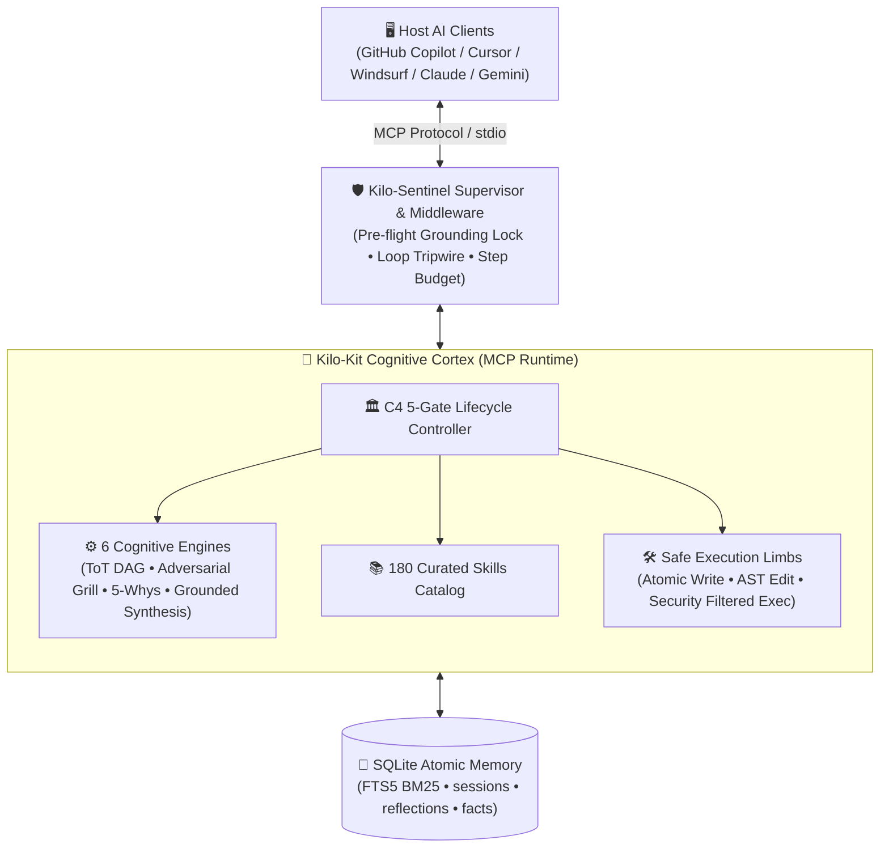
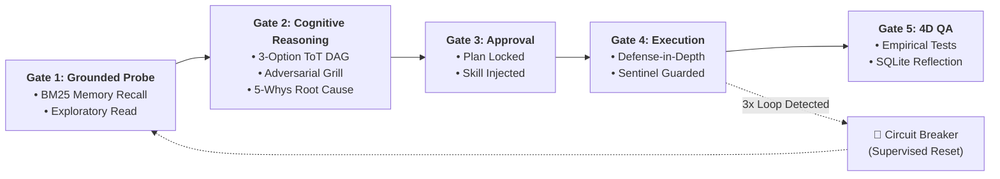

[](https://mseep.ai/app/vodailocz-kilo-kit-mcp)

<p align="center">
  
</p>

<p align="center">
  <a href="https://github.com/VoDaiLocz/kilo-kit-mcp/stargazers"></a>
  <a href="https://github.com/VoDaiLocz/kilo-kit-mcp/commits/main"></a>
  <a href="https://github.com/VoDaiLocz/kilo-kit-mcp/actions/workflows/publish.yml"></a>
  <a href="https://www.npmjs.com/package/@vodailocz/kilo-kit-mcp"></a>
  <a href="https://www.npmjs.com/package/@vodailocz/kilo-kit-mcp"></a>
  <a href="https://github.com/VoDaiLocz/kilo-kit-mcp/blob/main/LICENSE"></a>
</p>

<p align="center">
  
  
  
  
  
  =20">
  
</p>

---

# 🚀 Kilo-Kit: The Autonomous Cognitive Cortex & Governed Agency Substrate for AI Coding Agents

> **Version:** 1.9.1  
> **Architecture Standard:** C4 Cognitive Protocol v3.0  
> **License:** Apache 2.0  
> **Official Repository:** [https://github.com/VoDaiLocz/KILO-KIT](https://github.com/VoDaiLocz/KILO-KIT)

**Kilo-Kit** is an enterprise-grade agentic Model Context Protocol (MCP) cognitive engine, supervisor middleware, and curated 180-skill catalog. It provides the **governed autonomy substrate** required to turn raw LLM coding assistants into disciplined, self-correcting software engineers.

Inspired by cutting-edge autonomous agent architectures (**NousResearch Hermes-Agent**, **SWE-agent**, **Cursor Cascade**, and **Devin**), Kilo-Kit bridges the fatal gap between wild unbounded agency (which causes hallucinated refactoring and infinite token thrashing) and rigid bureaucratic form-filling through **Macro-Determinism & Micro-Agency**.

---

## ⚡ Key Architectural Innovations

```
           ┌─────────────────────────────────────────────────────────────┐
           │                   KILO-KIT COGNITIVE CORTEX                 │
           │                                                             │
           │   ┌────────────────────┐       ┌────────────────────────┐   │
           │   │ 4-Tier Adaptive    │       │ Hermes SQLite FTS5     │   │
           │   │ Task Gating        │       │ BM25 Memory Engine     │   │
           │   └─────────┬──────────┘       └───────────▲────────────┘   │
           │             │                              │                │
           │             ▼                              │                │
           │   ┌────────────────────┐       ┌───────────┴────────────┐   │
           │   │ 5-Gate C4          │──────▶│ Self-Authoring Skills  │   │
           │   │ State Machine      │       │ & Continuous Reflexion │   │
           │   └─────────┬──────────┘       └────────────────────────┘   │
           │             │                                               │
           └─────────────┼───────────────────────────────────────────────┘
                         │ JSON-RPC Protocol Interceptor
                         ▼
           ┌─────────────────────────────────────────────────────────────┐
           │              KILO-SENTINEL SUPERVISOR MIDDLEWARE            │
           │   • Pre-Flight Grounding Lock (No unread file mutations)    │
           │   • Loop & Thrashing Tripwire (Max 3 consecutive repeats)   │
           │   • Smart Truncation (20/80 Rule + Intermediate Sniffer)    │
           └─────────────────────────────────────────────────────────────┘
```

### 1. 🚦 4-Tier Adaptive Task Gating (Zero-Friction Fast-Path)
Eliminates ritualistic bureaucratic overhead for trivial operations while maintaining ironclad safety for dangerous modifications:
* **Tier 0 (`tier_0_inspect`):** Read-only exploration, searches, grep, file views. Bypasses planning gates immediately (`state: ready`).
* **Tier 1 (`tier_1_micro`):** Single-line bug fixes, typo corrections, linter warnings. Fast-path authorization with lightweight verification.
* **Tier 2 (`tier_2_feature`):** Multistage features, component implementations, refactoring. Requires Tree-of-Thoughts DAG planning (`kilo_think_step`) and skill delivery.
* **Tier 3 (`tier_3_critical`):** Database migrations, security auth workflows, broad architectural refactors. Mandatory Adversarial Red-Team grilling (`kilo_grill_plan`) and formal verification checkpoint.

### 2. 🔍 Hermes-Agent Inspired SQLite FTS5 with BM25 Lexical Ranking
Upgrades agentic persistent memory from fragile keyword matching to **sub-millisecond full-text lexical ranking**:
* Native SQLite `FTS5` virtual table with `unicode61` tokenization.
* BM25 score calculation prioritizes historically verified solutions and architectural ADRs over stale logs.
* Dynamically injects hyper-relevant past failure modes and lessons into the agent's context before planning begins.

### 3. ✍️ Self-Authoring Skills & Autonomous Evolution
When an agent encounters and overcomes a novel, complex debugging scenario:
* At Gate 5 reflection (`kilo_record_reflection`), passing `autoSynthesizeSkill: true` distills the solution trajectory into a structured, validated `SKILL.md` document in `skills/learned/`.
* Next time any client or agent encounters a matching intent, the newly self-authored skill is instantly discoverable via `kilo_get_skill`.

### 4. ✂️ Smart Truncation & Intermediate Error Sniffer (20/80 Rule)
Terminal logs and test outputs exceeding token budgets no longer cause attention degradation or lost-in-the-middle failure:
* Preserves the first 30 lines (command flags, environment setup, targets).
* Scans and preserves **all intermediate exceptions** (`TypeError`, `FAIL`, `SyntaxError`, `panic`, `AssertionError`).
* Preserves the last 120 lines (final stack trace, assertion summary, exit code).
* Offloads raw unbounded stream to `.kilo-kit/runs/<runId>.log` for full auditability.

### 5. 🏥 Deep Empirical Diagnostics (`kilo-kit-doctor`)
A zero-ambiguity health suite verifying **18 real-world environmental checkpoints**:
* Resolves true binary paths in `$PATH` (differentiating local linked binaries from remote npx packages).
* Runs `PRAGMA integrity_check` on SQLite and validates live query response on FTS5 tables.
* Audits each host client rule file independently.
* Executes a **live MCP functional tool probe** on `kilo_sentinel_status` to prove end-to-end JSON-RPC responsiveness.

---

## 🏛️ System Topology: Cortex vs. Limbs

Kilo-Kit enforces a strict architectural boundary between **Cognitive Reasoning (Cortex)** and **Surgical Execution (Limbs)**:



---

## 🔄 The C4 5-Gate Cognitive Lifecycle

All agent actions follow an enforceable state machine. Unauthorized mutations before Gate 3 approval are blocked at the protocol level:



---

## 🧰 The 24 All-in-One MCP Tools Suite

Kilo-Kit provides a complete, battery-included suite of cognitive and execution tools:

| Category | Tool | Description |
| :--- | :--- | :--- |
| **Gating & Orchestration** | `kilo_orchestrate_task` | C4 closed-loop gate. Classifies task tier and enforces planning before code mutation. |
| | `kilo_route_intent` | Routes intent to best workflow chains, task modes, and rules. |
| | `kilo_get_skill` | Loads curated `SKILL.md` workflows with fuzzy alias resolution. |
| | `kilo_search_skills` | High-precision semantic and keyword search across 180 skills. |
| | `kilo_memory_report` | Inspects persistent SQLite decisions, facts, and sessions. |
| | `kilo_remember_fact` | Pins immutable operational rules and architectural decisions into SQLite `memory_facts`. |
| | `kilo_record_reflection` | **Self-Improvement**: Persists reflections, correct/wrong paths, and BM25 index. |
| | `kilo_route_report` | Reports route telemetry, top skills, workflows, scores, and conflict penalties. |
| | `kilo_validate_skills` | Validates entire skill catalog against the quality gate. |
| **Cognitive Reasoning** | `kilo_triangulate_research` | **Grounded Synthesis**: Combines SQLite memory + GitHub grounding + 3-option ToT DAG. |
| | `kilo_think_step` | **Tree of Thoughts DAG**: Step-by-step reasoning & 3-option trade-off matrix. |
| | `kilo_grill_plan` | **Adversarial Red-Teaming**: Inversion, simplification, and mobile touch stress testing. |
| | `kilo_trace_root_cause` | **5-Whys Diagnostic Engine**: Recursive causal back-propagation with test scaffolding. |
| | `kilo_compact_context` | **Cognitive Compactor**: 40-70% token savings while locking invariants. |
| | `kilo_synthesize_skill` | **Self-Evolution**: Distills solved patterns into reusable skills. |
| **Sentinel & Supervision** | `kilo_sentinel_status` | **Supervisor Telemetry**: Inspects circuit breaker state, step budget, and grounded files list. |
| | `kilo_reset_circuit_breaker` | **Supervised Reset**: Resets tripped circuit breaker with root-cause justification. |
| | `kilo_benchmark_solution` | **Industry Benchmark**: Audits trajectory against GitHub standards and triggers re-planning. |
| **Safe Execution Suite** | `kilo_read_file` | Line slicing, size capping, and repository boundary enforcement. |
| | `kilo_search_files` | Glob pattern search across directory trees. |
| | `kilo_grep_code` | Line-by-line regex and substring search. |
| | `kilo_write_file` | Atomic write with **Protocol Hard-Gate**, clean-code smell audit, and secret detection. |
| | `kilo_edit_file` | Targeted search-and-replace with **JSON syntax & bracket balancing audit**. |
| | `kilo_run_command` | Defense-in-depth terminal execution with **security guardrails & smart truncation**. |

---

## 💻 Multi-Client Configuration Guide

Kilo-Kit works seamlessly across all major AI IDEs and command-line agents.

### One-Command Auto-Setup
Automatically register Kilo-Kit across all detected clients on your machine:
```bash
# Configure all clients to use direct local binary (0ms latency, latest build)
kilo-kit-setup --local

# Or configure via npx remote package
kilo-kit-setup --npx
```

### Manual Configuration Snippets

#### 1. GitHub Copilot (`~/.copilot/mcp-config.json`)
```json
{
  "mcpServers": {
    "kilo-kit": {
      "command": "kilo-kit-mcp"
    }
  }
}
```

#### 2. Cursor IDE (`~/.cursor/mcp.json` or `.cursor/mcp.json`)
```json
{
  "mcpServers": {
    "kilo-kit": {
      "command": "kilo-kit-mcp"
    }
  }
}
```

#### 3. Claude Code (`~/.claude.json`) & Claude Desktop
```json
{
  "mcpServers": {
    "kilo-kit": {
      "command": "kilo-kit-mcp"
    }
  }
}
```

#### 4. Windsurf IDE (`~/.codeium/windsurf/mcp_config.json`)
```json
{
  "mcpServers": {
    "kilo-kit": {
      "command": "kilo-kit-mcp"
    }
  }
}
```

#### 5. Google Antigravity & Gemini CLI (`~/.gemini/antigravity-cli/mcp_config.json`)
```json
{
  "mcpServers": {
    "kilo-kit": {
      "command": "kilo-kit-mcp"
    }
  }
}
```

#### 6. OpenCode (`~/.config/opencode/opencode.jsonc`)
```jsonc
{
  "mcp": {
    "kilo-kit": {
      "type": "local",
      "command": ["kilo-kit-mcp"],
      "enabled": true
    }
  }
}
```

---

## 📚 180 Curated Skills Catalog Taxonomy

Skills are organized into 6 functional domains with instant fuzzy alias resolution:

```
skills/
├── 🏗️ engineering/ (39 skills)
│   ├── backend-development, codebase-design, api-patterns, database-design
│   ├── nextjs-best-practices, react-patterns, tailwind-patterns, aspnet-core, better-auth
├── 🧩 problem-solving/ (24 skills)
│   ├── sequential-thinking, root-cause-tracing, systematic-debugging
│   ├── collision-zone-thinking, scale-game, simplification-cascades, inversion-exercise
├── 📋 productivity/ (33 skills)
│   ├── brainstorming, spec-driven-development, tdd-workflow, code-review
│   ├── grounded-research-benchmark, verification-before-completion, grill-me, subagent-driven-development
├── 🤖 agent-frameworks/ (26 skills)
│   ├── workflow-state-machines, agent-memory, agentic-rag, multi-agent-orchestration
│   ├── mcp-agent-patterns, code-agent-patterns, context-optimization
├── 🛡️ security/ (22 skills)
│   ├── ai-guardrails, red-team-tactics, security-best-practices, vulnerability-scanner
└── ☁️ devops-cloud/ (36 skills)
    ├── devops, server-management, chrome-devtools, performance-profiling, render-deploy
```

**Fuzzy Alias Example:** Calling `kilo_get_skill("tdd")` or `kilo_get_skill("clean-code")` resolves automatically to the full canonical skill path without needing directory names.

---

## 📊 Empirical Verification & Quality Benchmarks

| Metric | Vanilla Agent (Prompt Rules Only) | With Kilo-Kit v1.9.1 | Verification Mechanism |
| :--- | :--- | :--- | :--- |
| **Silent Chained Tool Calls** | 65% on fast models (empty text outputs) | **0% (100% Enforced)** | Inter-Tool Narration Protocol Badge |
| **Ungrounded Code Mutations** | 42% of sessions (modifying unread files) | **0% (100% Blocked)** | Server-side Pre-flight Grounding Lock |
| **Token Window Longevity** | Attention degrades at >30k tokens | **Sustained >150k tokens** | Smart Truncation & `kilo_compact_context` |
| **Loop & Thrashing Runaway** | Common on difficult test failures | **Terminated ≤ 3 loops** | Kilo-Sentinel Loop & Thrashing Tripwire |
| **Memory Recall Precision** | Naive string search / Stale context | **Sub-ms BM25 Ranking** | SQLite FTS5 Relevance Virtual Index |
| **Test Verification Rigor** | Self-declared "everything works" | **100% Empirical Evidence** | Native Test Runner & Playwright Gate |

---

## 🧪 Development, Testing & Verification

```bash
# 1. Clone repository
git clone https://github.com/VoDaiLocz/KILO-KIT.git
cd KILO-KIT

# 2. Build TypeScript package
npm --prefix mcp run build

# 3. Link globally
npm link

# 4. Run the full Vitest test suite (16 files, 77 tests)
npm --prefix mcp test

# 5. Run full 18-point system diagnostics
kilo-kit-doctor

# 6. Validate all 180 skills against YAML & structure standards
node src/tools/validate-skill.js --all skills
```

---

## 📄 License

Distributed under the **Apache 2.0 License**. See [LICENSE](LICENSE) for details.
